# pinyol

[](https://github.com/ipaud/pinyol/actions/workflows/ci.yml)

[English](README.md) · [Español](README.es.md) · Català

**[Juga tots els exemples al navegador](https://pinyol.ipaud.dev/ca/)**, amb les mesures del motor a la consola.

<p align="center"></p>

Un motor petit en C per a jocs 2D a la consola **Cirera**, una portàtil lliure feta amb un ESP32-S3 (pantalla tàctil de 480×320, botons, altaveu, microSD).

<p align="center">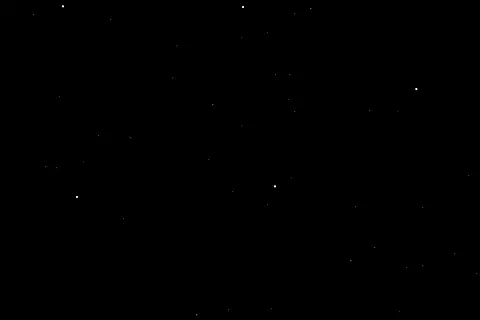</p>

Un joc és **una carpeta**: copia-la a la microSD de la consola dins de `games/<id>/` i apareix a la llista de jocs. La mateixa carpeta funciona en un simulador d'escriptori i al navegador. N'hi ha de dos tipus:

- **Jocs en Lua** (`"engine": "pinyol@2"`), de qualsevol gènere. El motor els dona una consola virtual a imatge de la Game Boy Advance: quatre capes de fons (tiles, girades i escalades, Mode 7), 128 sprites, paletes, transparències, finestres, mosaic i efectes per línia, amb el text dibuixat a sobre a resolució completa. Van a 60 fps a la consola. Més enllà de la pantalla i els botons: el micròfon (volum, to, picades de mans, gravacions), històries escrites com a text, el rellotge d'una cançó per a jocs de ritme, cossos que bolquen, rodolen i suren, clips de vídeo en llenços, el LED i la bateria de la consola, i consoles que juguen juntes. L'API: [docs/lua.md](docs/lua.md) (en anglès).
- **Aventures fetes de dades** (`"engine": "pinyol@1"`): JSON per a zones, diàlegs, objectes, trencaclosques i esdeveniments, sense codi. Els primers jocs del motor es van fer així: [docs/game-format.md](docs/game-format.md).

Un joc s'assembla a la consola per a la qual està fet, i el motor els mou tots: tria un aspecte i segueix-ne la recepta a
[docs/art.md](docs/art.md#0-choose-a-look). Cada imatge és un moment de joc de l'exemple d'aquell aspecte
(`docs/looks/shots.sh` les torna a treure).

| | |
|---|---|
| 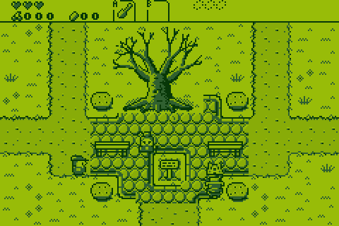 | 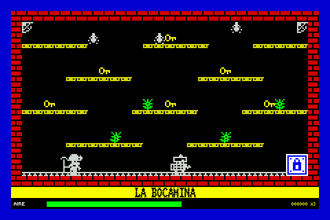 |
| **Game Boy**: [cerezo](examples/cerezo), una aventura a l'estil Zelda | **ZX Spectrum**: [socavon](examples/socavon), una mina, des de la càrrega de cinta |
| 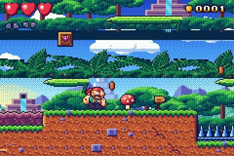 | 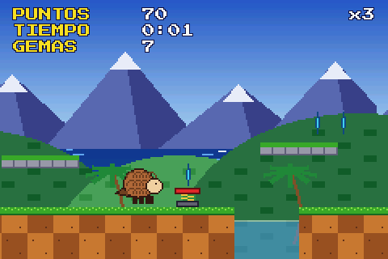 |
| **Game Boy Advance**: [plataformas](examples/plataformas) | **SNES / Mega Drive**: [veloz](examples/veloz), tot el seu art dibuixat amb codi |
| 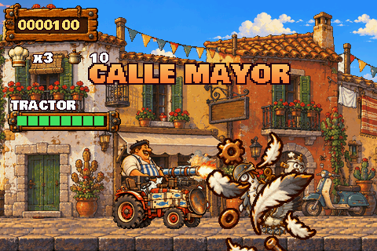 | 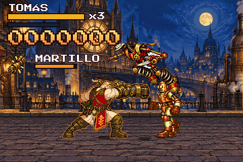 |
| **Neo Geo**: [duelo](examples/duelo) | **CPS2**: [torneo](examples/torneo) |
| 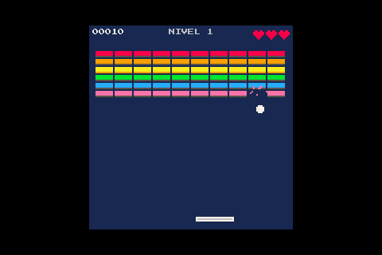 | 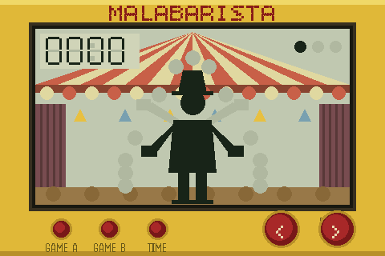 |
| **PICO-8**: [ladrillos](examples/ladrillos), sense imatges | **Maquineta LCD**: [huevos](examples/huevos), tot polígons |
| 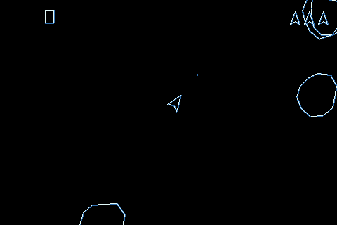 | 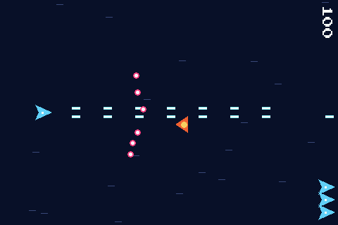 |
| **Recreativa vectorial**: [pozo](examples/pozo), sense imatges | **Pantalla vertical**: [tormenta](examples/tormenta), amb la consola de costat |
| 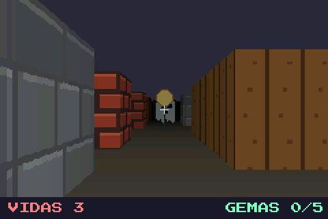 | 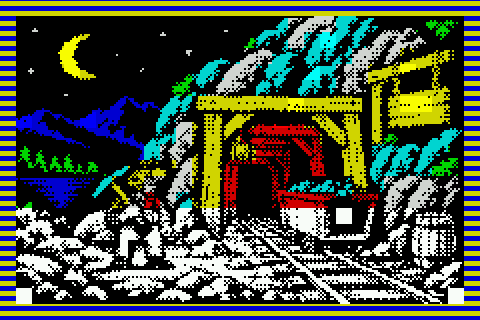 |
| **Primera persona**: [laberinto](examples/laberinto), `raycast()` | **ZX Spectrum**: la càrrega de cinta de [socavon](examples/socavon) |
| 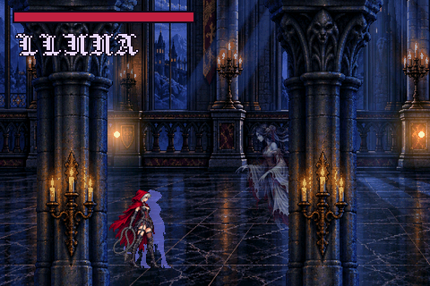 | 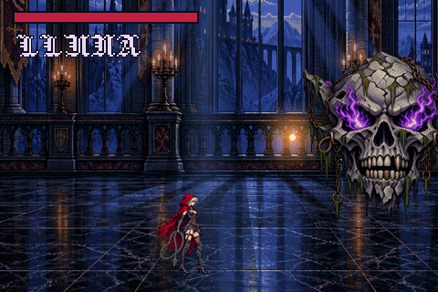 |
| **PlayStation / Saturn 2D**: [gotico](examples/gotico) | **PlayStation / Saturn 2D**: el seu cap final |

## Per començar

macOS: `brew install cmake sdl2 uv`. A Linux, instal·la aquests tres amb el teu gestor de paquets (`libsdl2-dev`).

```sh
cmake -B build && cmake --build build
./build/pinyol_sim --game examples/plataformas   # o naves, carreras, hola
ctest --test-dir build                       # valida cada exemple i en juga el guió de prova
```

| Acció | Teclat | Consola |
|---|---|---|
| Moure's | Fletxes / WASD | Creueta |
| A: fer servir, avançar, saltar, disparar | Enter, E, Espai, Z | A |
| B: enrere | Esc, Retrocés, X | B |
| Canviar d'objectiu, ajuda del trencaclosques | Tab, C | C |
| Bossa | I | MENU |
| Pausa | P | START |
| Tocar | Ratolí | Pantalla |
| Reiniciar el joc (el simulador també el reinicia quan deses un dels seus fitxers) | F5 | |
| Captura (PNG), la portada des de la pantalla, gravar la partida com a guió de prova, els últims 8 s en GIF | F6, F7, F8, F9 | |

## Fes el teu joc

### Amb un agent de codi

En un Mac, instal·la [Homebrew](https://brew.sh) (porta git i el compilador d'Apple) i un agent, per exemple
Codex: `brew install codex`, i després `codex login` amb un compte de ChatGPT. Clona aquest repositori, obre l'agent a
la seva carpeta (`codex`) i demana-li el joc que vulguis, en qualsevol idioma. Llegeix [AGENTS.md](AGENTS.md),
instal·la el que falta (aprova-ho quan t'ho demani: la instal·lació es fa fora de la seva sandbox), compila el motor,
fa el joc a `games/<id>/` i el juga amb una prova per comprovar-lo. `./build/pinyol_sim --game games/<id>` el juga a
la teva pantalla. L'[escala](https://pinyol.ipaud.dev/ca/crear/#codex) del web ensenya cinc jocs que Codex va fer així,
d'un joc de pales a un joc de plataformes de velocitat de Mega Drive, cadascun amb el seu encàrrec, el seu temps i els seus
tokens, i els seus fps a la consola.

### Sense codi: l'editor

<p align="center"><a href="https://pinyol.ipaud.dev/video/linea0.mp4">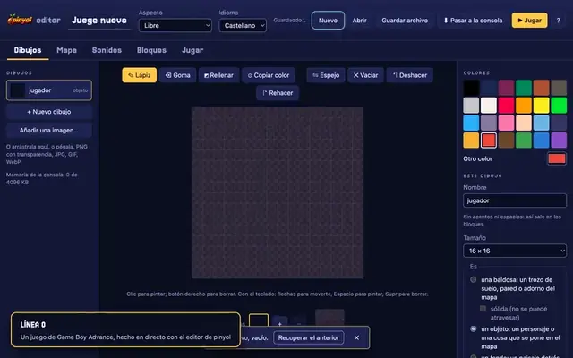</a><br>
<sub>LÍNEA 0, un joc de Game Boy Advance fet sencer amb l'editor, en directe, aquí accelerat: <a href="https://pinyol.ipaud.dev/video/linea0.mp4">el vídeo sencer</a>.</sub></p>

`editor/` és una pàgina web per fer un joc sense programar: dibuixa les imatges píxel a píxel (amb fotogrames per
animar-les) o porta-les de fitxers d'imatge (PNG amb transparència, JPG, una fila de fotogrames; deixats anar o
enganxats), en qualsevol dels colors de la consola; pinta-hi els mapes dels nivells i posa-hi els objectes (un
protagonista que camina i salta, enemics que patrullen o persegueixen, monedes), amb fins a tres imatges darrere de
cadascun que es mouen més a poc a poc que la càmera, i una portada abans del primer; fes els sons amb receptes
(moneda, làser, explosió, salt...) o porta'ls de fitxers (WAV, MP3, OGG...: efectes, i música per a cada nivell i la
portada, retallada i més alta o més baixa), o compon una cançó en una quadrícula (melodia, baix i bateria, en una
escala on tota nota encaixa); escriu les regles amb blocs ("quan el protagonista toca una moneda: treu l'altre, sona
moneda, suma 1 a punts"; "quan el protagonista toca la bandera: passa al nivell següent"), i amb els blocs de Diálogos
(personatges que parlen i pregunten, i el joc espera la resposta), Micrófono (quan piques de mans, quan bufes, quant
soroll) i Vídeo (un vídeo portat d'un fitxer o un GIF, a pantalla completa o en una finestra) i Guardar (un rècord o el progrés, que es queda a la consola); la música pot
ser també un `.mod` de tracker. La portada és a més la imatge del joc al menú de la consola, amb una línia, qui l'ha
fet i de què va. **Jugar** el juga allà mateix; **Pasar a la consola** l'envia pel cable USB (Chrome i Edge, amb Web Serial) o dona el zip per a la targeta.
Una guia curta acompanya qui l'obre per primer cop (un altre cop amb **?**); tot funciona també amb el teclat, i en un
mòbil o una tauleta. Un joc té un **aspecte** (Game Boy,
PICO-8, ZX Spectrum, 16 bits o lliure): els colors de la seva consola per a tots els dibuixos, les seves rajoles (de 8 o
16 píxels), la seva lletra i els colors dels seus textos; i un idioma per a les frases que diu el motor. Els objectes
poden tenir animacions amb nom (quiet, caminar, cop), i els blocs de Vides i temps posen cors i un compte enrere a la
pantalla. **Nuevo** comença des d'un de sis jocs per canviar, cadascun amb els seus dibuixos, nivells i regles: un joc
de plataformes, una aventura vista des de dalt (claus i portes), un matamarcians, un trencaclosques d'empènyer caixes i
**Abella**, un joc de Game Boy sencer en tres nivells (fet en directe a l'editor, i el primer de la Biblioteca del
web), i **LÍNEA 0**, un joc de Game Boy Advance en cinc nivells de cinc gèneres sobre un metro que no
obeeix les seves pròpies regles (fet també en directe: el seu vídeo és al web). La interfície és en castellà, català o anglès (es tria a dalt, a **Idioma**). Necessita al costat el reproductor web (mira
[més avall](#comparteix-un-joc-juga-hi-al-navegador) com compilar-lo):

```sh
python3 tools/make_editor.py dist/editor --player build-web
python3 -m http.server -d dist/editor    # obre http://localhost:8000
```

L'editor desa el projecte al navegador (IndexedDB) a mesura que canvia; **Guardar archivo** el desa en un fitxer
(`.pinyol.json`) i **Abrir** el torna a obrir. El joc que fa és Lua normal sobre la llibreria `kit`
([lib/kit.lua](lib/kit.lua)), així que es pot continuar a mà; porta la seva pròpia còpia de kit, així que es juga igual
en una consola amb un firmware més antic.

### En Lua

```sh
uv run tools/new_game.py games/elmeujoc --lua --title "El meu joc"
./build/pinyol_sim --game games/elmeujoc
```

Et queda un joc petit per canviar: una sala més gran que la pantalla, un personatge que s'hi passeja, gemmes per recollir, sons i un millor temps desat. `main.lua` és el joc, `room.lua` la sala com a text, i `art.py` dibuixa l'art i el converteix (canvia els seus PNG pels teus i torna'l a executar). **[docs/tutorial.md](docs/tutorial.md) continua des d'aquí pas a pas** (en anglès), fins a un joc a la consola i al navegador. Els nivells es poden dibuixar a [Tiled](https://www.mapeditor.org) i importar amb `tools/tiled2asset.py`. Art fet amb un model d'imatge (fons trets, fotogrames tallats, escala i peus ajustats): [docs/art.md](docs/art.md). Tota la resta és a [docs/lua.md](docs/lua.md), i els exemples n'ensenyen més:

| Exemple | El que ensenya |
|---|---|
| [plataformas](examples/plataformas) | un joc de plataformes: capes en paral·laxi, aigua transparent amb un scroll ondulat per línia, transicions en mosaic |
| [naves](examples/naves) | un matamarcians: un camp d'estrelles amb una velocitat per línia, un planeta que gira, explosions barrejades, un flaix |
| [carreras](examples/carreras) | una cursa de karts en Mode 7: un terra en perspectiva, rivals com a sprites escalats, voltes i posicions |
| [puzle](examples/puzle) | un trencaclosques lliscant per a la pantalla tàctil: una pista fantasma per barreja, una revelació en mosaic, música feta de notes |
| [aldea](examples/aldea) | una aventura vista des de dalt: un poble dibuixat a Tiled, gent amb diàlegs que s'escriuen lletra a lletra, capçades d'arbre per darrere de les quals passes |
| [estilos](examples/estilos) | l'aspecte propi d'un joc: fonts de la biblioteca, text amb contorn i ondulat, marcs tallats d'una imatge, imatges girades |
| [inventos](examples/inventos) | joguines sense gènere, només amb codi: pintar, terra que es trenca, estels generatius, triangles 3D, una pantalla partida |
| [juntos](examples/juntos) | consoles que juguen juntes per l'aire (ESP-NOW, sense router): una pissarra compartida, una pilota que passa de pantalla en pantalla |
| [asalto](examples/asalto) | un run and gun: una heroïna amb una metralladora, robots de ferralla que exploten, un tanc caminant al final d'un carrer llarg |
| [nubes](examples/nubes) | un matamarcians horitzontal sobre un mar de núvols: drons en formació, un cuirassat que omple el cel d'esferes (eixams) |
| [calle](examples/calle) | un beat-em-up en un carrer de neó de nit: profunditat, grups de brètols, la càmera que s'atura a cada baralla |
| [futbol](examples/futbol) | futbol cinc contra cinc en un camp el doble d'ample que la pantalla: quatre equipacions que són una imatge en quatre paletes |
| [moto](examples/moto) | una cursa de motos: la carretera al terra Mode 7 del món, la costa, el voral i els rivals a resolució completa a sobre |
| [duelo](examples/duelo) | un joc de lluita com els de Neo Geo: cada píxel a 480x320, un escenari en dues capes, lluitadors en fotogrames de 192x184 com a imatges empaquetades, flaixos i espurnes de cop, un rival que juga la consola |
| [torneo](examples/torneo) | un joc de lluita com els de CPS2: lluitadors en 15 colors i trenta fotogrames, mai ampliats, un terra en perspectiva dibuixat en bandes de files, columnes davant, el mateix lluitador dues vegades en altres colors |
| [mazmorra](examples/mazmorra) | un beat-em-up en una masmorra com els de CPS2: follets i esquelets en grups, torxes que fan pampallugues, columnes que passen per davant de tothom |
| [cerezo](examples/cerezo) | una aventura vista des de dalt com les últimes de Game Boy: un món de pantalles que llisquen, una masmorra, un cap, diàlegs, quatre tons que C canvia per les paletes de la Color; art i música fets amb codi |
| [socavon](examples/socavon) | una mina de plataformes d'una pantalla com les del ZX Spectrum, des de la càrrega de cinta (vora a ratlles, la pantalla en el seu propi ordre): vuit sales, blocs de dos colors, sprites que es trepitgen el color, claus que parpellegen, cintes, sòls que s'ensorren, una veu de pitit i un menú que ensenya els atributs |
| [veloz](examples/veloz) | un joc de plataformes de velocitat com els de les consoles de 16 bits: un mar mogut línia a línia, un cel en degradat, tolls transparents, un títol en Mode 7; un pangolí que es fa una bola |
| [ladrillos](examples/ladrillos) | un trencamaons com un cartutx de PICO-8: una pantalla de 128x128 en els seus setze colors, dibuixada de nou cada frame; sense imatges |
| [huevos](examples/huevos) | una maquineta LCD: figures enceses o apagades (els seus fantasmes encara es veuen) sobre una imatge impresa, un pas i un xiulet cada vegada |
| [pozo](examples/pozo) | un tirador vectorial de recreativa en un pou geomètric: línies brillants amb resplendor, fins i tot les lletres, sense imatges; el seu menú repeteix un fotograma línia a línia, com el dibuixava el feix |
| [tormenta](examples/tormenta) | un matamarcians vertical per jugar amb la consola de costat: un llenç dret que es veu girat, centenars de bales |
| [laberinto](examples/laberinto) | primera persona com la dibuixava Wolfenstein 3D: raycast() dibuixa el laberint des de dins, amb textures i boira, fantasmes i gemmes drets a dins |
| [gotico](examples/gotico) | la sala d'un castell de nit com la dibuixaven les consoles de 32 bits: llum d'espelmes sumada, un fantasma i els rastres d'un dash mig vistos, un cap calavera que gira i creix |
| [sonidos](examples/sonidos) | sons fets de números (una fàbrica de monedes, làsers, explosions), un theremin, un motor que segueix la velocitat, música en capes, un teclat que toca una mostra com qualsevol nota |
| [control](examples/control) | dirigir un informatiu de 1994 des de la sala de control: talls, cinta i rètols al ritme de la sintonia, les frases de la realitzadora escrites com una història en català i castellà, el LED de la consola com a pilot de càmera, un clip de vídeo en un monitor; després una càmera que no existeix et mira, et sent i sap quanta bateria et queda |
| [raton_de_biblioteca](examples/raton_de_biblioteca) | fet per Codex amb una frase en un clon nou: un ratolí amb aspecte de Game Boy en una biblioteca, formatge i gats (després posat a pantalla completa a mà) |
| [oxigeno](examples/oxigeno) | fet per Codex amb una frase: un astronauta amb aspecte de ZX Spectrum que busca ampolles d'oxigen, amb la seva pantalla de càrrega de cinta |
| [museo_nocturno](examples/museo_nocturno) | fet per Codex amb una frase: un museu de nit en primera persona, cinc quadres robats i vigilants |
| [paletes](examples/paletes) | fet per Codex amb una frase: pales i pilota contra la consola, en vectors, a 7 punts |
| [cripta](examples/cripta) | un metroidvania en vuit sales, cadascuna el seu mapa de Tiled importat amb `tools/tiled2asset.py` i col·locada al castell amb dues propietats del mapa: ales per a un segon salt, una ràfega que trenca les parets esquerdades, cada poder obre el camí al següent, estàtues que desen, un mapa de les sales recorregudes i una gàrgola; un solucionador demostra que el castell s'acaba en aquest ordre |
| [horizonte](examples/horizonte) | un dia sencer sobre el mar amb unes poques entrades de paleta, recolorides línia a línia amb `line_pal` i `line_pal_obj`: el cel que s'enfosqueix cap amunt, els núvols il·luminats per sota, el sol que s'enrogeix en pondre's-hi, l'aigua que brilla sota seu i la vela d'un vaixell pintada pel capvespre; A l'ensenya sense |
| [isla](examples/isla) | una illa isomètrica com la pintaven els jocs de GBA: el terra és un fons de tiles, i les columnes, les caixes, les palmeres, les gemmes i l'heroi són sprites que reben cada frame el seu número per profunditat, així l'heroi passa per darrere d'una torre i per davant d'una altra; cinc gemmes, unes a les quals s'arriba caminant i saltant, d'altres empenyent una caixa contra un pilar o al mar per creuar |
| [sima](examples/sima) | un roguelike per torns a la manera dels Mystery Dungeon de GBA: cinc pisos fets amb la llavor de la baixada (una de nova amb els ticks fins a prémer A, o la del dia per a tothom, amb `clock()`), escrits en un fons cel·la a cel·la amb `mset`, la boira del que no s'ha vist en un segon fons per sobre dels sprites i monstres que persegueixen l'heroi per un únic camp de `grid:distances`; un bot juga una baixada sencera als tests |
| [microjuegos](examples/microjuegos) | a la manera de WarioWare: vuit jocs de pocs segons (prémer, esquivar, comptar, picar, buscar, girar, estar quiet, un cap), quatre vides, una velocitat que puja cada quatre; cadascun deixa alguna cosa a la imatge o al so a propòsit (un fos, una finestra rodona, un mosaic, una nota, el LED) i `scene.go(..., {clean = true})` ho torna tot al seu lloc; una demostració jugada pels bots dels propis jocs |
| [tablero](examples/tablero) | tàctica per torns sobre una quadrícula, a la manera d'Advance Wars: dos exèrcits de quatre en un camp de 15 x 10 amb bosc, muntanya, un riu i dos ponts; abast, camins, camps de distància i un mapa de perill amb `grid`, ressaltats en una segona capa de la imatge (`mset`, `blend`), una IA que decideix amb el que té el jugador i una demostració de la IA contra ella mateixa |
| [combate](examples/combate) | un petit RPG: un prat, herba alta que amaga enemics i un combat per torns que comença amb els efectes propis de la imatge (flaix, ondulació línia a línia, mosaic, un iris amb `line_window`); enemics girats i escalats per una matriu, menús, un grup que puja de nivell i es desa |
| [pinball](examples/pinball) | una taula sencera a la pantalla, tres boles, quatre topalls i dues aletes que giren pel seu extrem (`physics` i el seu `w:drive`), un ressort que es tensa amb AVALL, una bola salvada |
| [costa_relampago](examples/costa_relampago) | fet per Codex en tres encàrrecs (el joc, el seu art generat, 60 fps a la consola): un esquirol amb aspecte de Mega Drive en una costa, capes a la seva pròpia velocitat i un mar mogut línia a línia |

### Com una aventura feta de dades

```sh
uv run tools/new_game.py games/elmeujoc --title "El meu joc"
./build/pinyol_sim --game games/elmeujoc
./build/pinyol_headless --game games/elmeujoc --validate     # cada ID existeix, cada text hi cap
```

`new_game.py` escriu un joc diminut però complet: dues zones, un protagonista, un amic amb una tria al diàleg, una clau, una porta tancada, un cofre i la pantalla final. Tot el seu art és provisional, dibuixat amb codi. Després fes-lo teu:

- **Text i lògica** són JSON. La referència completa és a [docs/game-format.md](docs/game-format.md).
- **Art**: dibuixa un PNG i converteix-lo amb el mateix ID. Els fulls de personatge són tires horitzontals en l'ordre de direccions N, E, S, O.
  ```sh
  uv run tools/png2asset.py carrer.png games/elmeujoc/assets BG_Z01 --type background
  uv run tools/png2asset.py heroi_camina.png games/elmeujoc/assets PJ_WALK --frames 16 --ms 125 --anchor 12,29
  uv run tools/png2asset.py lluitador.png games/elmeujoc/assets SPR_KAI --frames 11 --packed   # art gran: la seva pròpia paleta, una quarta part de la memòria
  ```
- **So**: WAV, PCM de 16 bits mono a 22.050 Hz.
- **Fonts**: `tools/font2fnt.py` converteix un TTF, OTF, BDF o un full PNG al format FNT del motor; en venen dotze de
  píxel lliures (`third_party/fonts`), així que cada joc pot tenir les seves pròpies lletres.
- **Proves**: un guió juga el joc amb entrades reals i comprova flags, zones i pantalles. Mira [tests/hola.script](tests/hola.script); s'executa amb `./build/pinyol_headless --game DIR --fresh --script FILE`, i `tools/record.sh DIR FILE out.mp4` grava la partida en vídeo.

## Un joc al seu propi repositori

Un joc més gran pot viure al seu propi repositori i compilar pinyol com a subprojecte, amb les seves pròpies proves:

```cmake
cmake_minimum_required(VERSION 3.21)
project(elmeujoc C)
set(GAME_DIR ${CMAKE_SOURCE_DIR}/games/elmeujoc)  # el que pinyol_sim i pinyol_headless obren per defecte
add_subdirectory(../pinyol pinyol)                # pinyol_core, pinyol_headless, pinyol_sim
enable_testing()
add_test(NAME validate COMMAND pinyol_headless --game ${GAME_DIR} --validate)
```

Les aventures de dades amb què va començar pinyol es compilen així.

## Comparteix un joc, juga-hi al navegador

```sh
python3 tools/pack_game.py games/elmeujoc -o dist/      # -> dist/elmeujoc.zip, amb una carpeta elmeujoc/ a dins
```

Descomprimit a la carpeta `games/` de la targeta, el joc queda instal·lat. El mateix zip es juga en un navegador: el simulador es compila amb [Emscripten](https://emscripten.org) a `player.html`, que juga el zip de qualsevol joc, donat com a `player.html?game=URL` o deixat anar a la pàgina, amb botons a la pantalla als mòbils, un comandament per USB o Bluetooth (distribució estàndard: el botó de baix és A) i les partides desades al navegador. `?lang=ca` o `?lang=en` posa els seus textos en català o en anglès.

```sh
emcmake cmake -B build-web -DCMAKE_BUILD_TYPE=Release
cmake --build build-web --target pinyol_player
cp dist/elmeujoc.zip build-web/
python3 -m http.server -d build-web     # obre http://localhost:8000/player.html?game=elmeujoc.zip
```

L'objectiu `pinyol_web` fa un `index.html` en lloc seu, amb un joc (`-DGAME_DIR=...`) empaquetat a dins.

Una prestatgeria sencera de jocs, cadascun jugable i descarregable, amb una imatge de la seva pantalla de títol:

```sh
python3 tools/make_gallery.py gallery/ --player build-web --headless build/pinyol_headless examples/*
python3 -m http.server -d gallery       # obre http://localhost:8000
```

Un joc acabat pot anar a la [Biblioteca](https://pinyol.ipaud.dev/biblioteca/) del web, per jugar-hi allà i descarregar-lo per a la consola: [puja'l amb un formulari](https://github.com/ipaud/pinyol/issues/new?template=biblioteca.yml), un robot l'obre, el juga deu segons i, quan el revisem, apareix allà.

<p align="center"><a href="https://pinyol.ipaud.dev/video/subir.mp4">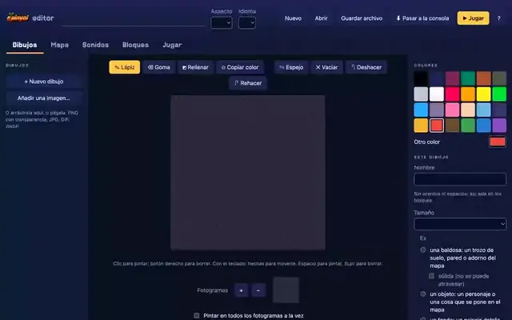</a><br>
<sub>Del teu joc a la Biblioteca, accelerat: <a href="https://pinyol.ipaud.dev/video/subir.mp4">el tutorial sencer</a>.</sub></p>

## Porta'l a la consola

El més ràpid: el web [instal·la l'última versió](https://pinyol.ipaud.dev/ca/consola/#consola) en una placa per USB,
des de Chrome o Edge, amb quinze jocs a la seva memòria flash.

El firmware de [firmware/](firmware/) és la plataforma de la consola: pantalla, tàctil, botons, àudio, microSD, bateria i actualitzacions per la targeta. Necessita [ESP-IDF 5.4](https://docs.espressif.com/projects/esp-idf/en/v5.4.2/esp32s3/get-started/).

```sh
. $IDF_PATH/export.sh
cd firmware
idf.py build
idf.py -p /dev/cu.usbmodem1101 flash        # el port de la teva placa
```

Un joc també pot anar pel cable USB, directament des de l'editor (Chrome o Edge) o des d'un terminal: la consola
l'escriu a la targeta (o, sense targeta, a la seva flash) i l'arrenca.

```sh
uv run --with pyserial tools/send_game.py games/elmeujoc     # la carpeta d'un joc, o el seu .zip
```

El firmware també grava jocs a la flash, així que la consola funciona sense targeta: `examples/hola` per defecte, o una llista, `idf.py -DFLASH_GAME="/abs/a;/abs/b" build` (i llavors grava també `build/game.bin`, a 0x420000). Qualsevol altre joc va a la microSD (FAT32) com a `games/<id>/`. Mantenir MENU premut dos segons surt d'un joc en Lua cap a la llista. Per actualitzar el firmware més endavant, copia `build/pinyol_console.bin` a la targeta com a `firmware.bin` (una consola amb una compilació de main del 21 o el 22 d'octubre de 2026 no pot: el seu driver de flash corrompia la memòria en esborrar; els firmwares publicats, el 0.3.0 i els anteriors, mai no van tenir aquest driver; grava-la una vegada pel cable, `esptool write_flash 0xf000 ota_data_initial.bin 0x20000 pinyol_console.bin`).

La consola arrenca al menú de **Cirera**, que és alhora un joc de pinyol ([firmware/cirera](firmware/cirera)) gravat a
la flash amb el firmware: una intro animada i després cada joc com una carta amb la seva portada, per triar amb la
creueta i A (B pregunta abans d'apagar la consola). La portada d'un joc és el seu `cover.rgb565`, una imatge de 240×160
que `tools/cover.py` treu d'un moment de joc; sense, la seva pantalla de títol (`assets/BG_TITLE`) o una carta amb el
seu nom.

Pins i perifèrics, cadascun amb la seva font: [docs/hardware.md](docs/hardware.md).

## Cirera al teu ordinador: Mac, Windows i Linux

La consola feta aplicació: el seu menú, els exemples a dins, i el .zip de qualsevol joc que deixis anar sobre la seva
finestra, instal·lat. Es descarrega de la [release «cirera»](https://github.com/ipaud/pinyol/releases/tag/cirera) o del [web](https://pinyol.ipaud.dev/consola/#escritorio), que explica com
obrir-la la primera vegada (encara no està signada per Apple ni per Microsoft). Els seus jocs i partides van a
`~/Library/Application Support/pinyol/Cirera` al Mac, a `%APPDATA%\pinyol\Cirera` al Windows i a
`~/.local/share/pinyol/Cirera` a Linux (x86_64 o aarch64, glibc 2.35 o posterior; un joc deixat anar es descomprimeix
amb unzip).

És `pinyol_sim` compilat com a aplicació, i `tools/make_app.py` l'empaqueta:

```sh
cmake -B build-app -DCMAKE_BUILD_TYPE=Release -DPINYOL_APP=ON
cmake --build build-app --target pinyol_sim             # -> build-app/Cirera (Cirera.exe al Windows)
python3 tools/make_app.py build-app/Cirera -o dist/     # -> dist/Cirera-mac.zip (Cirera-linux-*.tar.gz a Linux)
```

La de Windows es compila des d'un Mac o un Linux amb MinGW-w64 (`cmake/mingw-w64-x86_64.cmake`).
[.github/workflows/desktop.yml](.github/workflows/desktop.yml) les compila totes amb SDL a dins, així que no necessiten
res instal·lat, i obre cadascuna al seu sistema abans de publicar-la. El simulador també juga a la consola:
`pinyol_sim --console examples --menu firmware/cirera`.

## Juga-hi a RetroArch: RetroPie, Batocera, Lakka

El motor també és un core [libretro](https://www.libretro.com), que juga el zip d'un joc a RetroArch i a tot el
que s'hi basa, entre ells una Raspberry Pi amb RetroPie:

```sh
cmake -B build-release -DCMAKE_BUILD_TYPE=Release
cmake --build build-release --target pinyol_libretro    # -> build-release/pinyol_libretro.so
```

Com instal·lar-lo, els controls i el que encara no fa: [docs/libretro.md](docs/libretro.md) (en anglès).

## Com està fet

```
src/             el motor, C11 portable: sense capçaleres de SDL ni d'ESP-IDF (hal.h és tot el contracte amb la plataforma)
  ppu.c          el processador d'imatge virtual (capes, sprites, efectes) amb què dibuixen els jocs en Lua
  lua_game.c     pinyol@2: la sandbox de Lua i la seva API
platform/sdl/    simulador d'escriptori, l'aplicació Cirera (-DPINYOL_APP=ON), i els reproductors web quan es compila amb Emscripten
platform/desktop/ les icones de l'aplicació
platform/null/   pinyol_headless: validador i executor de proves sense finestra
platform/libretro/ el core libretro, per a RetroArch i RetroPie
platform/web/    les pàgines web al voltant dels reproductors
site/            el web (https://pinyol.ipaud.dev/), fet per site/build.py en castellà, català i anglès
firmware/        la consola: projecte d'ESP-IDF, compila src/ sense canvis; cirera/ és el seu menú, un joc de pinyol
examples/        jocs tal com van a la microSD: trenta-dos en Lua, hola com a dades
templates/lua/   el joc des del qual comença new_game.py --lua
tests/           guions de prova dels exemples, i les proves pròpies de la PPU
tools/           new_game.py, png2asset.py, tiled2asset.py, pack_game.py, make_gallery.py, font2fnt.py, clip2npv.py, ...
lib/             llibreries de Lua dins del motor, que qualsevol joc carrega amb require(): juice, particles, physics, keyboard, kit, story
editor/          l'editor web (HTML i JavaScript tal qual, sense compilar) i Blockly a vendor/
third_party/     cJSON, Lua 5.4, pocketmod, puff (unzip), libretro.h, la font Pixelify Sans i una biblioteca de fonts de píxel (fonts/)
```

El món són 240×160 píxels lògics dibuixats a 2× en un frame de 480×320; el text i la interfície fan servir la resolució completa. La lògica va a 60 ticks per segon a totes les plataformes. A la consola, el frame arriba al panell en franges de 32 files dibuixades directament des del joc mentre s'envia l'anterior, al compàs del refresc del panell; la imatge d'un joc en Lua la dibuixen els dos nuclis. Com va arribar a anar prou ràpid, mesurat: [docs/measurements.md](docs/measurements.md).

<p align="center">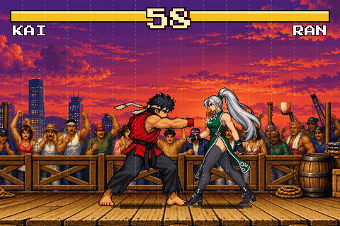<br>
<sub>A càmera lenta: un frame de debò triga 16,6 ms; aquí, 2,4 segons. En vermell, el nucli 0; en groc, el nucli 1.</sub></p>

## Estat

pinyol es va escriure primer per a dues aventures de dades, i després es va obrir amb Lua a qualsevol gènere. El que cal saber:

- L'API de Lua (`pinyol@2`) és nova i encara pot canviar; el format de dades (`pinyol@1`) és estable.
- Els textos d'interfície propis de les aventures de dades (menús, pausa, bossa) són en castellà.
- Alguns valors per defecte de pinyol@1 vénen del primer joc: sense un `"player"` a `game.json` el protagonista és `KLAUS` amb prefix de sprite `KL`, i la zona inicial per defecte és `Z01`. Posa'ls al teu `game.json`.
- El que es va fer i mesurar, pas a pas: [docs/progress.md](docs/progress.md).
- pinyol es va dir primer np2d: els jocs el `game.json` dels quals diu `"engine": "np2d@1"` o `"np2d@2"` continuen funcionant, i el repositori d'un joc encara pot fer servir els objectius `bp_core`, `bp_headless` i `bp_sim`.

## Llicència

pinyol té llicència MIT ([LICENSE](LICENSE)). Inclou [cJSON](third_party/cjson/LICENSE) (MIT), [Lua 5.4](third_party/lua/LICENSE) (MIT), [pocketmod](third_party/pocketmod/LICENSE) (MIT), [puff](third_party/puff/puff.h) (zlib), el [libretro.h](third_party/libretro/libretro.h) de libretro (MIT), la font [Pixelify Sans](third_party/pixelify/OFL.txt) i les fonts de píxel de [third_party/fonts](third_party/fonts/README.md) (totes SIL Open Font License 1.1). L'editor inclou [Blockly](editor/vendor/blockly/LICENSE) (Apache 2.0). El web serveix [ESP Web Tools](site/vendor/esp-web-tools/LICENSE) (Apache 2.0) per instal·lar el firmware, i el count.js de [GoatCounter](site/vendor/goatcounter/README.pinyol) (ISC) per comptar les visites; el firmware es construeix amb [ESP-IDF](https://github.com/espressif/esp-idf) (Apache 2.0, amb parts sota llicències MIT i BSD) i el reproductor web amb Emscripten i SDL2. L'aplicació d'escriptori porta SDL2 (zlib) i, al Windows, el runtime de MinGW-w64 ([ZPL 2.1 i MIT](third_party/mingw-w64/COPYING)). Tots els avisos que demanen són a [THIRD_PARTY_NOTICES.md](THIRD_PARTY_NOTICES.md), que també va amb cada release.

Les imatges, sons, música i vídeo dels exemples, la plantilla i les proves es van fer per a pinyol, generats amb un
model d'imatge o dibuixats i sintetitzats amb codi (l'`art.py` i `art/` de cada joc): es dediquen al domini públic
([CC0 1.0](https://creativecommons.org/publicdomain/zero/1.0/)), per fer-los servir als teus jocs com vulguis.

Game Boy, Game Boy Advance, PlayStation, Saturn, Mega Drive, Super Nintendo, Neo Geo, CPS2, PICO-8, ZX Spectrum,
Wolfenstein 3D i les altres consoles i jocs que s'anomenen aquí són marques dels seus propietaris. pinyol i Cirera no
hi tenen relació ni el seu suport: els noms només diuen a quin aspecte s'assembla un joc.
