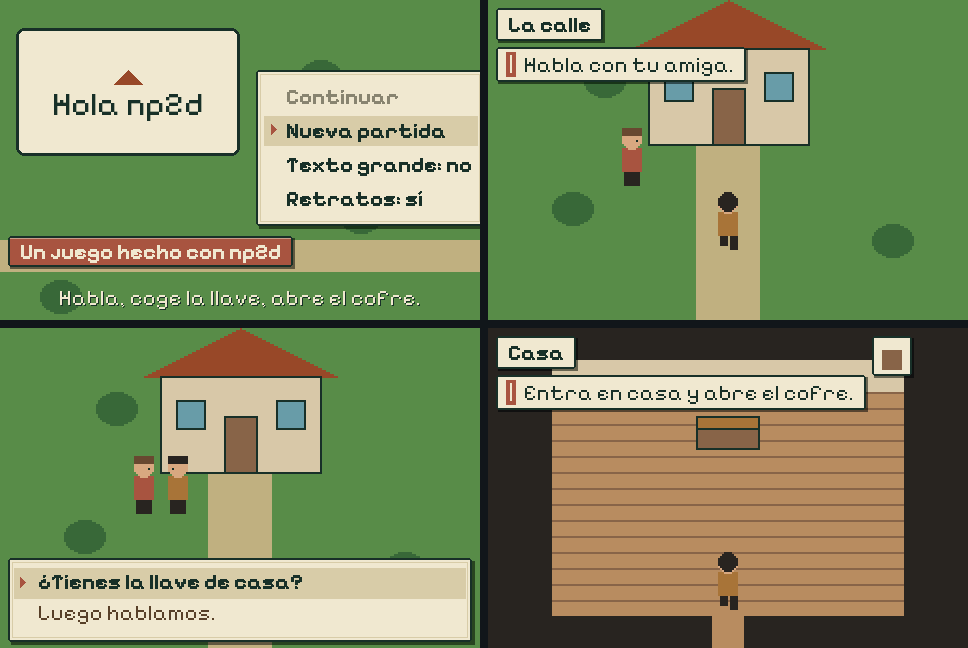

# np2d

A small C engine for 2D narrative games on the **RetroGo** console, an open-source handheld built on an ESP32-S3 (480×320 touch screen, buttons, speaker, microSD).

A game is **a folder of data**, not code: JSON for zones, dialogues, items and events, plus images, sounds and fonts. Copy the folder to the console's microSD under `games/<id>/` and it appears in the game list. The same folder runs in a desktop simulator and in the browser.



## Quick start

macOS: `brew install cmake sdl2 uv`. On Linux, install the same three with your package manager (`libsdl2-dev`).

```sh
cmake -B build && cmake --build build
./build/bp_sim                   # plays examples/hola
ctest --test-dir build           # validates the example and plays it start to end
```

| Action | Keyboard | Console |
|---|---|---|
| Move | Arrows / WASD | D-pad |
| Interact, advance | Enter, E, Space | A |
| Back | Esc, Backspace | B |
| Cycle target, puzzle help | Tab, C | C |
| Bag | I | MENU |
| Pause | P | START |
| Touch | Mouse | Screen |

## Make your own game

```sh
uv run tools/new_game.py games/mygame --title "My Game"
./build/bp_sim --game games/mygame
./build/bp_headless --game games/mygame --validate     # every ID exists, every text fits
```

`new_game.py` writes a tiny but complete game: two zones, a player, a friend with a dialogue choice, a key, a locked door, a chest and the end screen. All its art is placeholder drawn by code. Then make it yours:

- **Text and logic** are JSON. The full reference is [docs/game-format.md](docs/game-format.md).
- **Art**: draw a PNG and convert it under the same ID. Character sheets are horizontal strips in direction order N, E, S, W.
  ```sh
  uv run tools/png2asset.py street.png games/mygame/assets BG_Z01 --type background
  uv run tools/png2asset.py hero_walk.png games/mygame/assets PJ_WALK --frames 16 --ms 125 --anchor 12,29
  ```
- **Sound**: WAV, PCM 16-bit mono at 22,050 Hz.
- **Fonts**: `tools/ttf2fnt.py` turns a pixel TTF into the engine's FNT format.
- **Tests**: a script plays the game with real input and checks flags, zones and screens. See [tests/hola.script](tests/hola.script); run it with `./build/bp_headless --game DIR --fresh --script FILE`, and `tools/record.sh` records the run as a video.

## Play in the browser

The simulator also builds with [Emscripten](https://emscripten.org) into a web page with the game packed inside.

```sh
emcmake cmake -B build-web -DCMAKE_BUILD_TYPE=Release -DGAME_DIR=$PWD/examples/hola
cmake --build build-web
python3 -m http.server -d build-web     # open http://localhost:8000
```

The game's files ship as one `index.data`, so its size is the game's size: about 1 MB for the example, more with music.

## Run it on the console

The firmware in [firmware/](firmware/) is the console's platform: screen, touch, buttons, audio, microSD, a game list, battery and updates over the card. It needs [ESP-IDF 5.4](https://docs.espressif.com/projects/esp-idf/en/v5.4.2/esp32s3/get-started/).

```sh
. $IDF_PATH/export.sh
cd firmware
idf.py build
idf.py -p /dev/cu.usbmodem1101 flash        # your board's port
```

The firmware also bakes one game into the flash, so the console works without a card: `examples/hola` by default, or `idf.py -DFLASH_GAME=/abs/path/to/game build`. Every other game goes on the microSD (FAT32) as `games/<id>/`. To update the firmware later, copy `build/np2d_console.bin` to the card as `firmware.bin`.

Pins and peripherals, each with its source: [docs/hardware.md](docs/hardware.md).

## How it is built

```
src/             the engine, portable C11: no SDL or ESP-IDF headers (hal.h is the whole platform contract)
platform/sdl/    desktop simulator, and the web player when built with Emscripten
platform/null/   bp_headless: validator and test runner without a window
platform/web/    the web page around the player
firmware/        the console: ESP-IDF project, builds src/ unchanged
examples/hola/   the example game, as it goes on the microSD
tests/           test scripts for the example
tools/           new_game.py, png2asset.py, ttf2fnt.py, record.sh, remote.py
```

The world is 240×160 logical pixels drawn at 2× into a 480×320 frame; text and UI use the full resolution. Logic runs at 60 ticks per second on every platform. Every persistent fact is a named flag, so saving is writing flags and loading is setting them and entering a zone.

## Status

np2d was written for two games, *Bajo Pueblo* and *Geumgye*, and it shows:

- The built-in interface text (menus, pause, bag) is in Spanish.
- Some defaults come from the first game: without a `"player"` in `game.json` the player is `KLAUS` with sprite prefix `KL`, and the start zone defaults to `Z01`. Set them in your `game.json`.
- The engine's data format is versioned as `"engine": "np2d@1"` in `game.json` and may still change.

## License

np2d is MIT licensed ([LICENSE](LICENSE)). It includes [cJSON](third_party/cjson/LICENSE) (MIT) and the [Pixelify Sans](third_party/pixelify/OFL.txt) font (SIL Open Font License 1.1).
