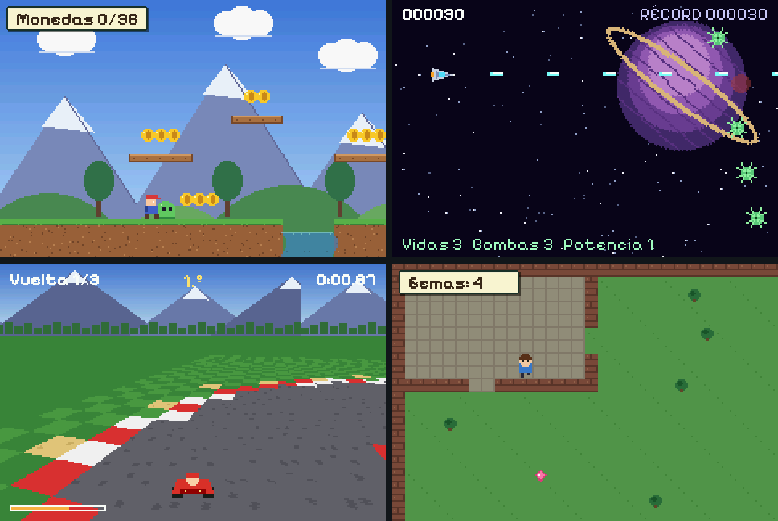

# np2d

A small C engine for 2D games on the **RetroGo** console, an open-source handheld built on an ESP32-S3 (480×320 touch screen, buttons, speaker, microSD).

A game is **a folder**: copy it to the console's microSD under `games/<id>/` and it appears in the game list. The same folder runs in a desktop simulator and in the browser. There are two kinds:

- **Lua games** (`"engine": "np2d@2"`), any genre. The engine gives them a virtual console modelled on the Game Boy Advance: four background layers (tiles, rotated and scaled, Mode 7), 128 sprites, palettes, transparency, windows, mosaic and per-line effects, with text drawn on top at full resolution. They hold 60 fps on the console. Beyond the screen and the buttons: the microphone (level, pitch, claps, recordings), stories written as plain text, a song's clock for rhythm games, bodies that tip over, roll and float, video clips on canvases, the console's LED and battery, and consoles playing together. The API: [docs/lua.md](docs/lua.md).
- **Adventures made of data** (`"engine": "np2d@1"`): JSON for zones, dialogues, items, puzzles and events, no code. Bajo Pueblo and Geumgye are made this way: [docs/game-format.md](docs/game-format.md).



## Quick start

macOS: `brew install cmake sdl2 uv`. On Linux, install the same three with your package manager (`libsdl2-dev`).

```sh
cmake -B build && cmake --build build
./build/bp_sim --game examples/plataformas   # or naves, carreras, hola
ctest --test-dir build                       # validates every example and plays its test script
```

| Action | Keyboard | Console |
|---|---|---|
| Move | Arrows / WASD | D-pad |
| A: interact, advance, jump, fire | Enter, E, Space, Z | A |
| B: back | Esc, Backspace, X | B |
| Cycle target, puzzle help | Tab, C | C |
| Bag | I | MENU |
| Pause | P | START |
| Touch | Mouse | Screen |
| Restart the game (the simulator also restarts it when you save one of its files) | F5 | |

## Make your own game

### Without code: the editor

`editor/` is a web page for making a game without programming: draw the pictures pixel by pixel (with frames for
animation) or bring them in from image files (PNG with transparency, JPG, a row of frames; dropped or pasted), in
any of the console's colours; paint the levels' maps with them and put the objects on them (a player who walks and
jumps, enemies that patrol or chase, coins), with up to three pictures behind each that move slower than the camera,
and a cover before the first; make the sounds from recipes (coin, laser, explosion, jump...) or bring them in from
files (WAV, MP3, OGG...: effects, and music for each level and the cover, cut and made louder or softer), or compose a
song on a grid (melody, bass and drums, in a scale where every note fits); write the rules
with blocks ("when the hero touches a coin: remove the other, play coin, add 1 to points"; "when the hero touches
the flag: go on to the next level"), and with the blocks of Diálogos (characters who speak and ask, the game waiting
for the answer), Micrófono (when you clap, when you blow, how loud) and Vídeo (a video brought in from a file or a GIF,
over the whole screen or in a window). **Jugar** plays it right there; **Pasar a la consola** sends it over the USB
cable (Chrome and Edge, with Web Serial) or gives the zip for the card. A short guide walks a first-time user through
it (again with **?**); everything works from the keyboard too, and on a phone or a tablet. **Nuevo** starts from one of four small games to change, each with
its own drawings, levels and rules: a platformer, an adventure seen from above (keys and doors), a space shooter
and a box-pushing puzzle. The interface is in
Spanish. It needs the web player beside it (see [below](#share-a-game-play-it-in-the-browser) to build it):

```sh
python3 tools/make_editor.py dist/editor --player build-web
python3 -m http.server -d dist/editor    # open http://localhost:8000
```

The editor keeps the project in the browser (IndexedDB) as it changes; **Guardar** saves it to a file (`.np2d.json`) and
**Abrir** opens it again. The game it makes is ordinary Lua on the `kit` library ([lib/kit.lua](lib/kit.lua)), so it
can be carried on by hand; it carries its own copy of kit, so it plays the same on a console with older firmware.

### In Lua

```sh
uv run tools/new_game.py games/mygame --lua --title "My Game"
./build/bp_sim --game games/mygame
```

You get a small game to change: a room bigger than the screen, a character to walk around it, gems to pick up, sounds and a best time saved. `main.lua` is the game, `room.lua` the room as text, and `art.py` draws the art and converts it (replace its PNGs with your own and run it again). **[docs/tutorial.md](docs/tutorial.md) takes it from there step by step**, to a game on the console and in the browser. Levels can be drawn in [Tiled](https://www.mapeditor.org) and imported with `tools/tiled2asset.py`. Everything else is in [docs/lua.md](docs/lua.md), and the examples show more:

| Example | What it shows |
|---|---|
| [plataformas](examples/plataformas) | a platformer: parallax layers, see-through water with a wavy per-line scroll, mosaic transitions |
| [naves](examples/naves) | a shoot-'em-up: a star field with a speed per line, a turning planet, blended explosions, a flash |
| [carreras](examples/carreras) | a kart race in Mode 7: a perspective floor, rivals as scaled sprites, laps and positions |
| [puzle](examples/puzle) | a sliding puzzle for the touch screen: a ghost hint by blending, a mosaic reveal, music made of notes |
| [aldea](examples/aldea) | a top-down adventure: a village drawn in Tiled, people with typed-out dialogue, tree tops you walk behind |
| [estilos](examples/estilos) | a game's own look: fonts from the library, outlined and wavy text, frames cut from a picture, turned pictures |
| [inventos](examples/inventos) | toys of no genre, from code alone: painting, land that breaks, generative trails, 3D triangles, a split screen |
| [juntos](examples/juntos) | consoles playing together over the air (ESP-NOW, no router): a shared whiteboard, a ball passed from screen to screen |
| [asalto](examples/asalto) | a run and gun: a heroine with a machine gun, scrap robots that explode, a walking tank at the end of a long street |
| [nubes](examples/nubes) | a horizontal shoot-em-up over a sea of clouds: drones in formation, a battleship that fills the sky with orbs (swarms) |
| [calle](examples/calle) | a beat-em-up on a neon street at night: depth, groups of thugs, the camera stopping at each fight |
| [futbol](examples/futbol) | five a side on a pitch twice the screen's width: four kits that are one picture in four palettes |
| [moto](examples/moto) | a motorbike race: the road on the world's Mode 7 floor, the coast, the roadside and the rivals at full resolution over it |
| [duelo](examples/duelo) | a fighting game as a Neo Geo's: every pixel at 480x320, a stage in two layers, fighters in 192x184 frames as packed pictures, hit flashes and sparks, a rival played by the console |
| [sonidos](examples/sonidos) | sounds made from numbers (a factory of coins, lasers, explosions), a theremin, an engine that follows the speed, music in layers |
| [control](examples/control) | directing a 1994 newscast from the control room: cuts, tape and captions on the beat of the theme, the producer's lines written as a story in Catalan and Spanish, the console's LED as the tally light, a video clip on a monitor; then a camera that does not exist looks at you, hears you and knows your battery |

### As an adventure made of data

```sh
uv run tools/new_game.py games/mygame --title "My Game"
./build/bp_sim --game games/mygame
./build/bp_headless --game games/mygame --validate     # every ID exists, every text fits
```

`new_game.py` writes a tiny but complete game: two zones, a player, a friend with a dialogue choice, a key, a locked door, a chest and the end screen. All its art is placeholder drawn by code. Then make it yours:

- **Text and logic** are JSON. The full reference is [docs/game-format.md](docs/game-format.md).
- **Art**: draw a PNG and convert it under the same ID. Character sheets are horizontal strips in direction order N, E, S, W.
  ```sh
  uv run tools/png2asset.py street.png games/mygame/assets BG_Z01 --type background
  uv run tools/png2asset.py hero_walk.png games/mygame/assets PJ_WALK --frames 16 --ms 125 --anchor 12,29
  uv run tools/png2asset.py fighter.png games/mygame/assets SPR_KAI --frames 11 --packed   # big art: its own palette, a quarter of the memory
  ```
- **Sound**: WAV, PCM 16-bit mono at 22,050 Hz.
- **Fonts**: `tools/font2fnt.py` turns a TTF, OTF, BDF or PNG sheet into the engine's FNT format; twelve free pixel
  fonts come with it (`third_party/fonts`), so each game can have its own letters.
- **Tests**: a script plays the game with real input and checks flags, zones and screens. See [tests/hola.script](tests/hola.script); run it with `./build/bp_headless --game DIR --fresh --script FILE`, and `tools/record.sh` records the run as a video.

## A game in its own repo

A bigger game can live in its own repository and build np2d as a subproject, with its own tests:

```cmake
cmake_minimum_required(VERSION 3.21)
project(mygame C)
set(GAME_DIR ${CMAKE_SOURCE_DIR}/games/mygame)  # what bp_sim and bp_headless open by default
add_subdirectory(../np2d np2d)                  # bp_core, bp_headless, bp_sim
enable_testing()
add_test(NAME validate COMMAND bp_headless --game ${GAME_DIR} --validate)
```

Bajo Pueblo and Geumgye are built this way.

## Share a game, play it in the browser

```sh
python3 tools/pack_game.py games/mygame -o dist/      # -> dist/mygame.zip, a folder mygame/ inside
```

Unzipped into the card's `games/` folder, the game is installed. The same zip plays in a browser: the simulator builds with [Emscripten](https://emscripten.org) into `player.html`, which plays any game's zip, given as `player.html?game=URL` or dropped on the page, with on-screen buttons on phones and saves kept in the browser.

```sh
emcmake cmake -B build-web -DCMAKE_BUILD_TYPE=Release
cmake --build build-web --target np2d_player
cp dist/mygame.zip build-web/
python3 -m http.server -d build-web     # open http://localhost:8000/player.html?game=mygame.zip
```

The `np2d_web` target makes `index.html` instead, with one game (`-DGAME_DIR=...`) packed inside.

A whole shelf of games, each playable and downloadable, with a picture of its title screen:

```sh
python3 tools/make_gallery.py gallery/ --player build-web --headless build/bp_headless examples/*
python3 -m http.server -d gallery       # open http://localhost:8000
```

## Run it on the console

The firmware in [firmware/](firmware/) is the console's platform: screen, touch, buttons, audio, microSD, a game list, battery and updates over the card. It needs [ESP-IDF 5.4](https://docs.espressif.com/projects/esp-idf/en/v5.4.2/esp32s3/get-started/).

```sh
. $IDF_PATH/export.sh
cd firmware
idf.py build
idf.py -p /dev/cu.usbmodem1101 flash        # your board's port
```

A game can also go over the USB cable, straight from the editor (Chrome or Edge) or from a terminal: the console
writes it to the card (or, with none, its flash) and starts it.

```sh
uv run --with pyserial tools/send_game.py games/mygame     # a game folder, or a game's .zip
```

The firmware also bakes games into the flash, so the console works without a card: `examples/hola` by default, or a list, `idf.py -DFLASH_GAME="/abs/a;/abs/b" build` (then flash `build/game.bin` too, at 0x420000). Every other game goes on the microSD (FAT32) as `games/<id>/`. Holding MENU for two seconds leaves a Lua game for the list. To update the firmware later, copy `build/np2d_console.bin` to the card as `firmware.bin`.

Pins and peripherals, each with its source: [docs/hardware.md](docs/hardware.md).

## How it is built

```
src/             the engine, portable C11: no SDL or ESP-IDF headers (hal.h is the whole platform contract)
  ppu.c          the virtual picture processor (layers, sprites, effects) that Lua games draw with
  lua_game.c     np2d@2: the Lua sandbox and its API
platform/sdl/    desktop simulator, and the web players when built with Emscripten
platform/null/   bp_headless: validator and test runner without a window
platform/web/    the web pages around the players
firmware/        the console: ESP-IDF project, builds src/ unchanged
examples/        games as they go on the microSD: sixteen in Lua, hola as data
templates/lua/   the game new_game.py --lua starts from
tests/           test scripts for the examples, and the PPU's own tests
tools/           new_game.py, png2asset.py, tiled2asset.py, pack_game.py, make_gallery.py, font2fnt.py, clip2npv.py, ...
lib/             Lua libraries built into the engine, require()d by any game: juice, particles, physics, keyboard, kit, story
editor/          the web editor (plain HTML and JavaScript, no build step) and Blockly in vendor/
third_party/     cJSON, Lua 5.4, pocketmod, the Pixelify Sans font and a library of pixel fonts (fonts/)
```

The world is 240×160 logical pixels drawn at 2× into a 480×320 frame; text and UI use the full resolution. Logic runs at 60 ticks per second on every platform. On the console the frame goes to the panel in 32-row strips drawn straight from the game while the previous strip is sent, in step with the panel's refresh; a Lua game's picture is drawn by both cores. How it got fast enough, measured: [docs/measurements.md](docs/measurements.md).

## Status

np2d was written for two games, *Bajo Pueblo* and *Geumgye*, and then opened up with Lua for any genre. What to know:

- The Lua API (`np2d@2`) is new and may still change; the data format (`np2d@1`) is stable.
- The built-in interface text of data adventures (menus, pause, bag) is in Spanish.
- Some np2d@1 defaults come from the first game: without a `"player"` in `game.json` the player is `KLAUS` with sprite prefix `KL`, and the start zone defaults to `Z01`. Set them in your `game.json`.
- What was done and measured, step by step: [docs/progress.md](docs/progress.md).

## License

np2d is MIT licensed ([LICENSE](LICENSE)). It includes [cJSON](third_party/cjson/LICENSE) (MIT), [Lua 5.4](third_party/lua/LICENSE) (MIT), [pocketmod](third_party/pocketmod/LICENSE) (MIT) the [Pixelify Sans](third_party/pixelify/OFL.txt) font and the pixel fonts in [third_party/fonts](third_party/fonts/README.md) (all SIL Open Font License 1.1). The editor includes [Blockly](editor/vendor/blockly/LICENSE) (Apache 2.0).
