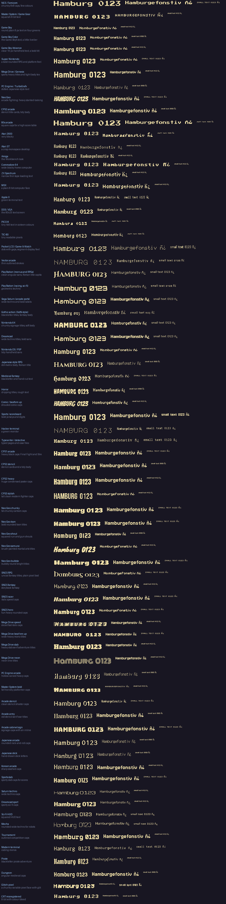

<!-- made by `tools/font2fnt.py --markdown docs/fonts.md`: edit third_party/fonts/catalog.json, not this -->
# Fonts for every look

Each console's games had their own letters, and those are not ours to ship (Nintendo's, Sony's and Sega's fonts are theirs). What pinyol carries instead are free fonts, all under the SIL Open Font License, that give the same *feel*, grouped into **packs**: a `title`, a `body` and a `small` font for each look. Pick the pack of the console your game is made for (docs/art.md, "Choose a look") and make its fonts into your game:

```sh
uv run tools/font2fnt.py --pack snes games/mygame     # fonts/snes_title.fnt, snes_body.fnt, snes_small.fnt
```

```lua
text("PUSH START", 240, 60, {font = "snes_title", align = "center", color = 0xFFFFFF})
text("Hamburgefonstiv", 20, 140, {font = "snes_body"})
```

`uv run tools/font2fnt.py --catalog` lists the packs, `--sheet out.png [pack]` draws them. A game can have 16 fonts of its own besides the four every game has, so mix packs freely (`--prefix` renames a pack's files). Letters are the 256 of Windows-1252: Spanish, Catalan, French, German, Portuguese, Italian and the Nordic languages, not Japanese or Cyrillic. Fonts with an `*` keep a Reserved Font Name: what is made from them (your `.fnt`) must not be called by it, so the packs name their files by pack (`snes_title`), never by font.



## Packs

| Pack | Look | Title | Body | Small |
|---|---|---|---|---|
| `nes` | **NES / Famicom**: chunky 8x8 caps, few colours | Press Start 2P* | Press Start 2P* | Silkscreen |
| `master_system` | **Master System / Game Gear**: squarish 8-bit text | Silkscreen Bold | Silkscreen | Tiny5 |
| `game_boy` | **Game Boy**: round plain 8 px text on four greens | Jersey 10 | Pixelify Sans | Tiny5 |
| `game_boy_color` | **Game Boy Color**: the Game Boy's text, a little livelier | Jersey 15 | Pixelify Sans | Micro 5 |
| `gba` | **Game Boy Advance**: clear 16 px handheld text, a bold title | Jersey 15 | Pixelify Sans | Tiny5 |
| `snes` | **Super Nintendo**: a bold rounded RPG and platform feel | Jersey 20 | Pixelify Sans | Silkscreen |
| `mega_drive` | **Mega Drive / Genesis**: sporty heavy titles and tight body text | Jersey 25 | Jersey 10 | Tiny5 |
| `pc_engine` | **PC Engine / TurboGrafx**: dotted Japanese-style text | Doto | DotGothic16 | Micro 5 |
| `neo_geo` | **Neo Geo**: arcade fighting: heavy slanted-looking titles | Bangers | Jersey 15 | Silkscreen |
| `cps2` | **CPS2 arcade**: stencil title cards, tidy body | Black Ops One | Jersey 15 | Micro 5 |
| `arcade_80s` | **80s arcade**: square caps for a high score table | Press Start 2P* | Press Start 2P* | Bytesized |
| `atari_2600` | **Atari 2600**: very blocky | Sixtyfour | Bytesized | Bytesized |
| `atari_st` | **Atari ST**: a crisp monospace desktop | Workbench | IBM Plex Mono* | Tiny5 |
| `amiga` | **Amiga**: the Workbench look | Workbench | Workbench | Tiny5 |
| `commodore_64` | **Commodore 64**: wide blocky home computer | Sixtyfour | Sixtyfour | Tiny5 |
| `zx_spectrum` | **ZX Spectrum**: narrow thin tape-loading text | Workbench | Tiny5 | Tiny5 |
| `msx` | **MSX**: a plain 8-bit computer face | Sixtyfour | Tiny5 | Tiny5 |
| `apple_ii` | **Apple II**: green terminal text | VT323 | VT323 | VT323 |
| `dos_vga` | **DOS / VGA**: the 80x25 text screen | IBM Plex Mono Bold* | VT323 | Micro 5 |
| `pico8` | **PICO-8**: tiny 4x6 text in sixteen colours | Bytesized | Micro 5 | Bytesized |
| `tic80` | **TIC-80**: tiny readable pixels | Tiny5 | Tiny5 | Bytesized |
| `pocket_lcd` | **Pocket LCD / Game & Watch**: dots with gaps, segment-display feel | Bitcount Grid Single | Doto | Handjet |
| `vector_arcade` | **Vector arcade**: thin outlined strokes | Major Mono Display | Share Tech Mono* | Geo* |
| `playstation` | **PlayStation (menus and RPGs)**: clean angular sans, Roman title capitals | Cinzel Decorative Bold* | Chakra Petch | Chakra Petch |
| `playstation_scifi` | **PlayStation (racing, sci-fi)**: geometric techno | Orbitron* | Chakra Petch | Geo* |
| `saturn` | **Sega Saturn (arcade ports)**: wide techno and bold labels | Audiowide* | Russo One* | Chakra Petch |
| `gothic` | **Gothic action (SotN-style)**: blackletter titles, fantasy body | Jacquard 24 | Metamorphous* | Jacquarda Bastarda 9 |
| `n64` | **Nintendo 64**: chunky signage titles, soft body | Bungee | Righteous* | Chakra Petch |
| `dreamcast` | **Dreamcast**: wide techno titles, bold sans | Audiowide* | Russo One* | Chakra Petch |
| `ds_psp` | **Nintendo DS / PSP**: tidy handheld sans | Jersey 20 | Pixelify Sans | Tiny5 |
| `jrpg` | **Japanese-style RPG**: dot-matrix body, Roman title | Cinzel | DotGothic16 | Micro 5 |
| `fantasy` | **Medieval fantasy**: blackletter and hand-cut text | UnifrakturCook* | MedievalSharp* | Silkscreen |
| `horror` | **Horror**: dripping titles, rough text | Creepster* | New Rocker* | Micro 5 |
| `comic_beatemup` | **Comic / beat'em up**: shouted comic caps | Bangers | Righteous* | Tiny5 |
| `sports` | **Sports / scoreboard**: bold jerseys and digits | Jersey 25 | Jersey 15 | Jersey 10 |
| `terminal` | **Hacker terminal**: a green monitor | Major Mono Display | VT323 | Courier Prime |
| `typewriter` | **Typewriter / detective**: typed pages and case files | Courier Prime Bold | Courier Prime | Courier Prime |
| `cps1` | **CPS1 arcade**: heavy block caps: Final Fight and Street Fighter 2 era | Passion One* | Jersey 15 | Silkscreen |
| `cps2_stencil` | **CPS2 stencil**: stencil cards and a tidy body | Saira Stencil One | Jersey 15 | Micro 5 |
| `cps2_heavy` | **CPS2 heavy**: huge condensed poster caps | Anton | Jersey 15 | Tiny5 |
| `cps3` | **CPS3 stylish**: tall clean modern fighter caps | Bebas Neue | Pixelify Sans | Tiny5 |
| `neo_geo_chunky` | **Neo Geo chunky**: fat chunky cartoon caps | Bowlby One* | Jersey 15 | Silkscreen |
| `neo_geo_toon` | **Neo Geo toon**: bold rounded toon titles | Titan One* | Jersey 15 | Silkscreen |
| `neo_geo_shout` | **Neo Geo shout**: squared run and gun shouts | Squada One* | Jersey 10 | Micro 5 |
| `neo_geo_samurai` | **Neo Geo samurai**: brush-painted martial arts titles | Knewave* | Pixelify Sans | Tiny5 |
| `neo_geo_bubble` | **Neo Geo bubble**: bubbly round bright titles | Chango* | Jersey 15 | Silkscreen |
| `snes_rpg` | **SNES RPG**: uncial fantasy titles, plain pixel body | Uncial Antiqua* | Pixelify Sans | Silkscreen |
| `snes_fantasy` | **SNES fantasy**: storybook fantasy | Macondo* | Jersey 15 | Tiny5 |
| `snes_kart` | **SNES racer**: italic speed caps | Racing Sans One* | Jersey 15 | Silkscreen |
| `snes_hero` | **SNES hero**: fun heavy rounded caps | Lilita One* | Pixelify Sans | Silkscreen |
| `mega_drive_speed` | **Mega Drive speed**: sliced fast italic caps | Faster One* | Jersey 10 | Tiny5 |
| `mega_drive_beat` | **Mega Drive beat 'em up**: wide heavy mono titles | Rubik Mono One | Jersey 10 | Silkscreen |
| `mega_drive_slab` | **Mega Drive slab**: heavy slab serif adventure titles | Alfa Slab One* | Jersey 10 | Tiny5 |
| `mega_drive_neon` | **Mega Drive neon**: neon line titles | Monoton* | Jersey 10 | Tiny5 |
| `pc_engine_arcade` | **PC Engine arcade**: hollow carved heavy caps | Rampart One | DotGothic16 | Micro 5 |
| `master_system_bold` | **Master System bold**: fat friendly platformer caps | Sigmar One | Silkscreen | Tiny5 |
| `arcade_stencil` | **Arcade stencil**: clean stencil shooter caps | Allerta Stencil* | VT323 | Silkscreen |
| `arcade_army` | **Arcade army**: old stencil serif war titles | Stardos Stencil* | Jersey 15 | Micro 5 |
| `arcade_neon_sign` | **Arcade cabinet sign**: signage caps with an inline | Bungee Inline | Jersey 15 | Silkscreen |
| `japan_arcade` | **Japanese arcade**: rounded rock-and-roll caps | RocknRoll One | DotGothic16 | Micro 5 |
| `japan_stick` | **Japanese stick**: hand-drawn stick letters | Stick | DotGothic16 | Micro 5 |
| `korea_arcade` | **Korean arcade**: sharp slashed caps | Gugi | Jersey 15 | Tiny5 |
| `sports_slab` | **Sports slab**: sporty slab caps for scores | Jockey One* | Jersey 15 | Silkscreen |
| `saturn_techno` | **Saturn techno**: wide techno caps | Michroma | Chakra Petch | Tiny5 |
| `dreamcast_sport` | **Dreamcast sport**: sporty sci-fi caps | Exo 2 | Chakra Petch | Tiny5 |
| `scifi_hud` | **Sci-fi HUD**: squared HUD text | Aldrich* | Electrolize* | Iceland* |
| `mecha` | **Mecha**: rounded wide techno for robots | Turret Road | Aldrich* | Iceland* |
| `tournament` | **Tournament**: outlined competition caps | Tourney | Jersey 15 | Tiny5 |
| `terminal_modern` | **Modern terminal**: coding monos | Kode Mono | Space Mono | Anonymous Pro* |
| `pirate` | **Pirate**: blackletter pirate adventure | Pirata One* | Macondo* | Tiny5 |
| `dungeon` | **Dungeon**: angular medieval caps | Germania One* | Jersey 15 | Micro 5 |
| `glitch_pixel` | **Glitch pixel**: a chunky variable pixel face with glitchy colour-bleed | Bitcount Prop | Tiny5 | Micro 5 Charted |
| `crt_misregister` | **CRT misregistered**: 8-bit with colour-bleed | Sixtyfour Convergence | Tiny5 | Micro 5 |

## The fonts

| Font | Feel | Folder |
|---|---|---|
| Press Start 2P* | 80s arcade and NES-era caps and small letters, 8 px | `third_party/fonts/pressstart2p` |
| Silkscreen | small clean capitals for labels, 8 px | `third_party/fonts/silkscreen` |
| Silkscreen Bold | the same, heavier | `third_party/fonts/silkscreen` |
| Tiny5 | tiny 5 px pixel text that still reads: PICO-8, ZX Spectrum, small HUDs | `third_party/fonts/tiny5` |
| Micro 5 | tiny, a little rounder | `third_party/fonts/micro5` |
| Bytesized | the smallest, numbers and credits | `third_party/fonts/bytesized` |
| Pixelify Sans | round friendly pixel sans: Game Boy, GBA, handheld RPGs | `third_party/fonts/..` |
| Jersey 10 | sport and scoreboard, 16-bit | `third_party/fonts/jersey10` |
| Jersey 15 | sport, a size up | `third_party/fonts/jersey15` |
| Jersey 20 | bold 16-bit titles | `third_party/fonts/jersey20` |
| Jersey 25 | big bold arcade titles | `third_party/fonts/jersey25` |
| Sixtyfour | wide blocky 8-bit home computer (C64, MSX, Atari) | `third_party/fonts/sixtyfour` |
| Workbench | an Amiga Workbench-style bitmap face with serifed bits | `third_party/fonts/workbench` |
| Handjet | LED and dot-matrix printer | `third_party/fonts/handjet` |
| Doto | a dot-matrix display, round dots | `third_party/fonts/doto` |
| Bitcount Single | a bitmap text face with a tidy computer feel | `third_party/fonts/bitcountsingle` |
| Bitcount Grid Single | pixels with a grid between them: pocket LCD games, game and watch | `third_party/fonts/bitcountgridsingle` |
| DotGothic16 | Japanese dot-matrix, 16 px: JRPG body text | `third_party/fonts/dotgothic16` |
| VT323 | a computer terminal: DOS, Apple II, hacker screens | `third_party/fonts/vt323` |
| Jacquard 12 | blackletter pixels: gothic action games | `third_party/fonts/jacquard12` |
| Jacquard 24 | blackletter pixels, bigger, for titles | `third_party/fonts/jacquard24` |
| Jacquarda Bastarda 9 | a gentler blackletter | `third_party/fonts/jacquardabastarda9` |
| Orbitron* | geometric sci-fi: PlayStation racers, Dreamcast | `third_party/fonts/orbitron` |
| Oxanium | squared sci-fi, mecha | `third_party/fonts/oxanium` |
| Geo* | a narrow technical face | `third_party/fonts/geo` |
| Major Mono Display | outlined strokes: vector arcade, Tron | `third_party/fonts/majormonodisplay` |
| Share Tech Mono* | a technical monospace: vector arcade, a cockpit | `third_party/fonts/sharetechmono` |
| Audiowide* | wide rounded techno titles: Dreamcast, Saturn arcade | `third_party/fonts/audiowide` |
| Russo One* | bold squared sans for readable menus | `third_party/fonts/russoone` |
| Black Ops One | stencil military arcade titles | `third_party/fonts/blackopsone` |
| Chakra Petch | clean angular sans: PS1/PS2 menus, sci-fi HUDs | `third_party/fonts/chakrapetch` |
| Chakra Petch Bold | the same, bold | `third_party/fonts/chakrapetch` |
| Zen Dots | wide futuristic titles | `third_party/fonts/zendots` |
| Wallpoet* | stencilled wall lettering | `third_party/fonts/wallpoet` |
| Cinzel | Roman capitals: JRPG and fantasy titles | `third_party/fonts/cinzel` |
| Cinzel Decorative Bold* | fancy Roman capitals for titles | `third_party/fonts/cinzeldecorative` |
| MedievalSharp* | a hand-cut medieval face for text | `third_party/fonts/medievalsharp` |
| Metamorphous* | fantasy book text | `third_party/fonts/metamorphous` |
| UnifrakturCook* | bold blackletter titles | `third_party/fonts/unifrakturcook` |
| UnifrakturMaguntia* | classic blackletter | `third_party/fonts/unifrakturmaguntia` |
| New Rocker* | Celtic heavy metal | `third_party/fonts/newrocker` |
| Creepster* | horror titles: dripping letters | `third_party/fonts/creepster` |
| Bungee | chunky signage capitals: N64 titles, arcade signs | `third_party/fonts/bungee` |
| Bangers | comic book shout: beat'em ups, fighters | `third_party/fonts/bangers` |
| Righteous* | rounded retro-futuristic text | `third_party/fonts/righteous` |
| Courier Prime | typewriter | `third_party/fonts/courierprime` |
| Courier Prime Bold | typewriter, bold | `third_party/fonts/courierprime` |
| Cutive Mono | a light typewriter | `third_party/fonts/cutivemono` |
| IBM Plex Mono* | a clear monospace: DOS and terminals | `third_party/fonts/ibmplexmono` |
| IBM Plex Mono Bold* | the same, bold | `third_party/fonts/ibmplexmono` |
| Passion One* | heavy rounded block caps: Final Fight and Street Fighter 2 title cards | `third_party/fonts/passionone` |
| Teko | tall condensed techno-sport caps: fighting game HUDs | `third_party/fonts/teko` |
| Anton | very heavy condensed poster caps: CPS2 and arcade logos | `third_party/fonts/anton` |
| Bowlby One* | fat chunky caps: Neo Geo cartoon titles | `third_party/fonts/bowlbyone` |
| Chango* | round bubbly heavy letters: bright Neo Geo and kart titles | `third_party/fonts/chango` |
| Titan One* | bold rounded caps: SNES platformers and Neo Geo toons | `third_party/fonts/titanone` |
| Squada One* | blocky squared shout caps: sports and run and gun | `third_party/fonts/squadaone` |
| Racing Sans One* | italic speed caps: racing games, Mega Drive and SNES | `third_party/fonts/racingsansone` |
| Saira Stencil One | stencil caps: military and CPS2 cards | `third_party/fonts/sairastencilone` |
| Stardos Stencil* | old stencil serif: army crates, war games | `third_party/fonts/stardosstencil` |
| Allerta Stencil* | clean stencil sans: arcade shooters | `third_party/fonts/allertastencil` |
| Rubik Mono One | wide heavy mono caps: Streets of Rage-style titles | `third_party/fonts/rubikmonoone` |
| Faster One* | fast sliced italic caps: Sonic-speed, racers | `third_party/fonts/fasterone` |
| Gugi | sharp slashed caps: Korean-arcade, fighters | `third_party/fonts/gugi` |
| Jockey One* | sporty slab caps: sports games, scoreboards | `third_party/fonts/jockeyone` |
| Alfa Slab One* | heavy slab serif: 16-bit adventure and Mega Drive titles | `third_party/fonts/alfaslabone` |
| Sigmar One | fat friendly caps: Master System, platformers | `third_party/fonts/sigmarone` |
| Bebas Neue | tall clean caps: CPS3 and modern fighting titles | `third_party/fonts/bebasneue` |
| Lilita One* | fun heavy rounded caps: SNES hero games | `third_party/fonts/lilitaone` |
| Knewave* | brush-painted shout: samurai and martial arts titles | `third_party/fonts/knewave` |
| Monoton* | neon line caps: Mega Drive and 80s arcade neon | `third_party/fonts/monoton` |
| Bungee Inline | signage caps with an inline: arcade cabinets | `third_party/fonts/bungeeinline` |
| Pirata One* | blackletter pirate caps: RPG and adventure titles | `third_party/fonts/pirataone` |
| Almendra* | calligraphic fantasy text: SNES RPG menus | `third_party/fonts/almendra` |
| Uncial Antiqua* | uncial fantasy letters: SNES and Mega Drive RPG titles | `third_party/fonts/uncialantiqua` |
| Macondo* | quirky storybook capitals: fantasy adventures | `third_party/fonts/macondo` |
| Eagle Lake* | ornate calligraphy: old RPG scrolls | `third_party/fonts/eaglelake` |
| Germania One* | angular medieval caps: dungeon and brawler titles | `third_party/fonts/germaniaone` |
| Electrolize* | rounded techno text: Saturn and Dreamcast menus | `third_party/fonts/electrolize` |
| Michroma | wide techno caps: Saturn and PlayStation sci-fi | `third_party/fonts/michroma` |
| Exo 2 | sporty sci-fi text: Dreamcast and racers | `third_party/fonts/exo2` |
| Aldrich* | squared HUD text: shooters and mecha | `third_party/fonts/aldrich` |
| Quantico* | military HUD text: tactical games | `third_party/fonts/quantico` |
| Iceland* | tight tech text: small HUD labels | `third_party/fonts/iceland` |
| Nova Mono* | square mono: computer terminals | `third_party/fonts/novamono` |
| Tourney | outlined competition caps: tournament cards | `third_party/fonts/tourney` |
| Turret Road | rounded wide techno: robots and mecha | `third_party/fonts/turretroad` |
| Kode Mono | modern coding mono: terminals and hacker games | `third_party/fonts/kodemono` |
| Space Mono | geometric mono: retro-future terminals | `third_party/fonts/spacemono` |
| Anonymous Pro* | classic coding mono: plain terminals | `third_party/fonts/anonymouspro` |
| Saira | clean techno text with widths and weights: HUDs | `third_party/fonts/saira` |
| Rajdhani | squared Devanagari-inspired techno: sports HUDs | `third_party/fonts/rajdhani` |
| Stick | hand-drawn stick letters: Japanese-arcade look | `third_party/fonts/stick` |
| RocknRoll One | rounded rock-and-roll caps: Japanese arcade | `third_party/fonts/rocknrollone` |
| Rampart One | hollow-carved heavy caps: PC Engine style | `third_party/fonts/rampartone` |
| Sixtyfour Convergence | 8-bit with colour-bleed styles: CRT-misregistered titles | `third_party/fonts/sixtyfourconvergence` |
| Micro 5 Charted | tiny pixel text with chart marks | `third_party/fonts/micro5charted` |
| Bitcount Prop | proportional pixel text with many styles | `third_party/fonts/bitcountpropsingle` |

Each folder holds the font's `OFL.txt`. The fonts are free to use, change and share, also in games that are sold, as long as the font is not sold on its own; `THIRD_PARTY_NOTICES.md` carries their notices.
