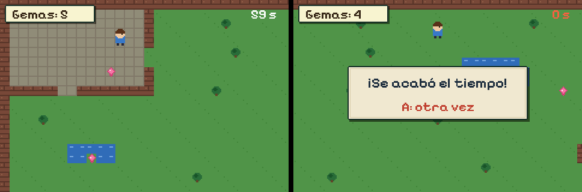

# Your first game, step by step

From nothing to a game you can play on the RetroGo console, in the browser and on your computer. Every step below
was done exactly as written, and the game at the end passes its test. Allow an hour.

What you will make: *Mi cueva*, a room to explore with gems to pick up against the clock, with sounds and music.
After it, [lua.md](lua.md) has the whole API and the five examples in `examples/` show what else the engine does.



## 1. Build the engine

macOS: `brew install cmake sdl2 uv`. Linux: the same three from your package manager (`libsdl2-dev`).

```sh
git clone <pinyol's repository> pinyol && cd pinyol
cmake -B build && cmake --build build
./build/pinyol_sim --game examples/aldea  # a game, to check it works: arrows and Z
```

## 2. Start your game

```sh
uv run tools/new_game.py games/micueva --lua --title "Mi cueva"
./build/pinyol_sim --game games/micueva
```

`games/micueva/` now holds a small game: walk with the arrows (or WASD), pick up the five gems. It is all yours:

```
main.lua    the game: _init() once, _update() 60 times a second, _draw() before each frame
room.lua    the room, as text: # wall, T tree, ~ water, * a gem, @ where you start
art.py      draws the art from room.lua and converts it into assets/ (run it again after changes)
assets/     what the engine reads: tiles, maps, palettes, sprite sheets
audio/      sounds (WAV)
```

Open `main.lua` in any editor and leave `pinyol_sim` running: each time you save a file of the game, it starts again
with your change (F5 does it by hand). Each step below is a small change to `main.lua`.

## 3. Walk faster

Near the top:

```lua
local TILE, SPEED = 8, 2       -- was 1.2: pixels per tick
```

## 4. Race against the clock

Under the line `local timer, cam_x, cam_y = 0, 0, 0`, a limit of one minute (in ticks, 60 a second):

```lua
local LIMIT = 60 * 60 -- a minute, in ticks
```

In `_update()`, after the line that sets `player.step`, the time running out:

```lua
  if timer >= LIMIT then state = "lost" end
```

And in `_draw()`, after the line that writes `"Gemas: "`, the seconds left (red at the end) and a panel when time
is up. Text is drawn at the screen's full 480×320, over the game's 240×160 world:

```lua
  local left = math.max(0, LIMIT - timer) // 60
  text(left .. " s", SCREEN_W - 20, 12, left < 10 and 0xFF6040 or 0xFFFFFF, "bold", "right")
  if state == "lost" then
    panel(90, 110, 300, 90)
    text("¡Se acabó el tiempo!", SCREEN_W // 2, 126, 0x203040, "large_bold", "center")
    text("A: otra vez", SCREEN_W // 2, 166, 0xC04030, "bold", "center")
  end
```

Pressing A already starts again: the template's `_update()` calls `start()` on A whenever the state is not `"play"`.

## 5. A bump when you walk into a wall

The console has synthesised voices, like the Game Boy Advance's sound channels: `tone(voice, pitch, options)`. In
`_update()`, replace the line that moves the player sideways with:

```lua
  if not blocked(player.x + dx * SPEED, player.y) then player.x = player.x + dx * SPEED
  elseif dx ~= 0 and timer % 15 == 0 then tone(2, 90, {wave = "noise", vol = 0.3, decay = 0.05}) end
```

A short burst of noise, four times a second while you push against a wall.

## 6. Music made of notes

Just above `function _update()`:

```lua
local TUNE = {"C4", "E4", "G4", "E4", "A3", "C4", "E4", "C4", "F3", "A3", "C4", "A3", "G3", "B3", "D4", "B3"}
```

And first thing inside `_update()`, after `timer = timer + 1`:

```lua
  if timer % 12 == 0 then -- a note every 12 ticks, round and round
    tone(0, TUNE[timer // 12 % #TUNE + 1], {wave = "triangle", vol = 0.2, decay = 0.2})
  end
```

A tracker module (`.mod`, from MilkyTracker or OpenMPT) or a WAV also work: put it in `audio/` and call
`music("NAME")` once.

## 7. Change the room

`room.lua` is the room, one character per 8×8 tile. Draw a pond with a gem in the middle: change two lines of
grass into

```lua
  "#,,,,,,~~~~~,,,,,,,,,,,,,,,,,,,,,,,,,,,,,,,,,,#",
  "#,,,,,,~~*~~,,,,,,,,,,,,,,,,,,,,,,,,,,,,,,,,,,#",
```

(take the `*` out of the line you replaced, so there are still five gems). Then draw the art again:

```sh
cd games/micueva && python3 art.py --draw && cd ../..
```

The water is solid (`~` is in `SOLID` in `main.lua`), so that gem can only be reached from below. For bigger
levels, draw them in [Tiled](https://www.mapeditor.org) and import them with `tools/tiled2asset.py`
([lua.md](lua.md#levels-from-tiled); `examples/aldea` is made that way).

To use your own drawings instead of the ones made by code, replace the PNGs in `art/` (same size, same frames) and
run `python3 art.py` without `--draw`.

## 8. A test that plays it

A test script plays the game with real input and checks what happened. Save this as
`games/micueva/tests/micueva.script`:

```
# Mi cueva: faster walking, the gems, the time limit
new
tick 5
expect_lua state == "play" and gems[5] ~= nil
lua x0 = player.x
hold RIGHT 20
expect_lua player.x > x0 + 30
# a gem, picked up by standing on it
lua player.x, player.y = gems[1].x - 4, gems[1].y - 6
tick 2
expect_lua gems[5] == nil
# a minute later, time is up
tick 3600
expect_lua state == "lost"
press A
expect_lua state == "play" and gems[5] ~= nil
expect_ok
```

```sh
./build/pinyol_headless --game games/micueva --fresh --script games/micueva/tests/micueva.script --check-strips
```

`PASS` means the game does what the test says. Run it after every change: it takes a fraction of a second, and it
also draws every frame the way the console does (`--check-strips`).

## 9. Play it on the console and in the browser

```sh
python3 tools/pack_game.py games/micueva -o dist/      # -> dist/micueva.zip
```

- **Console:** unzip `micueva.zip` into the microSD card's `games/` folder. It shows in the game list.
- **Browser:** with the web player built (see the README), open `player.html?game=micueva.zip`, or drop the zip on
  the player page. It works on phones too, with buttons on the screen.
- **Share it:** the zip is the whole game.

## Where next

- [lua.md](lua.md): everything the engine does: four background layers that scroll, turn and zoom (Mode 7),
  128 sprites, transparency, windows, mosaic, effects per line, text, sound, saved games.
- The examples, each a different genre: `plataformas` (platformer), `naves` (shoot-'em-up), `carreras` (Mode 7
  racing), `puzle` (touch puzzle), `aldea` (adventure with dialogue). Their `main.lua` is short and commented.
